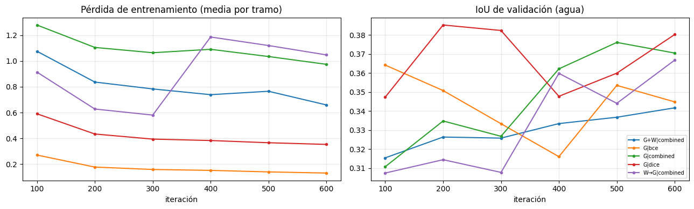
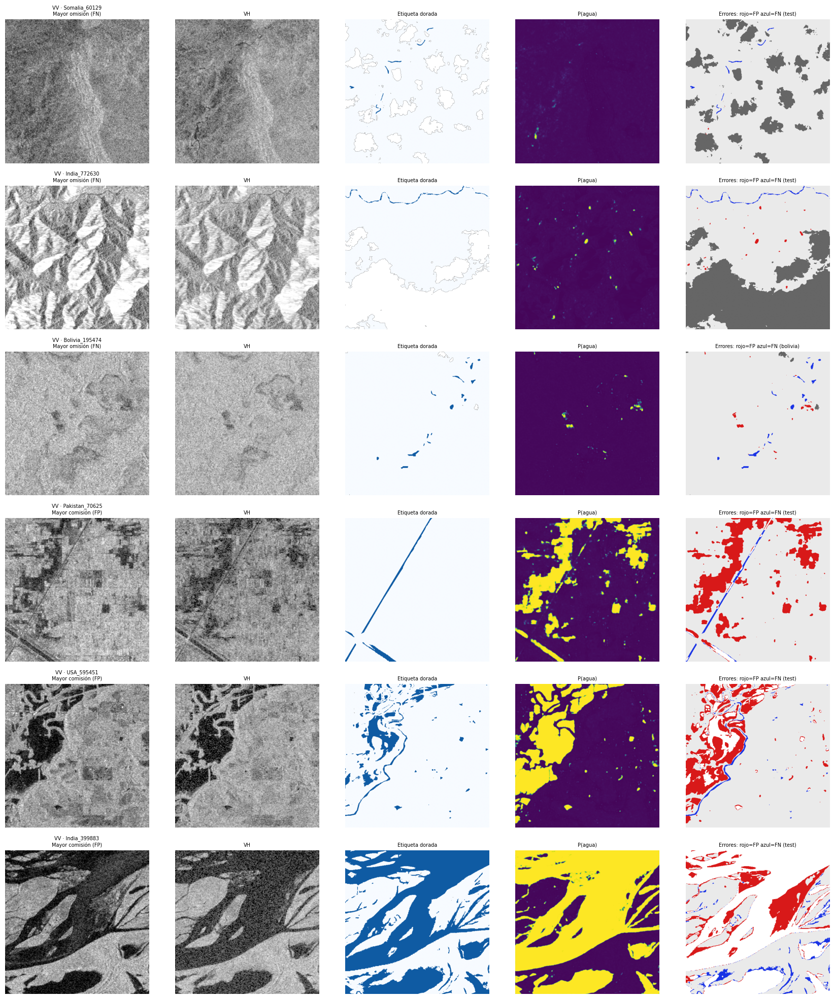

# Mapeo de inundaciones con radar Sentinel-1 mediante una U-Net

Segmentación binaria de **agua / no agua** en imágenes SAR **Sentinel-1 (VV, VH)** del dataset **Sen1Floods11**,
con una **U-Net implementada desde cero en PyTorch** (sin bibliotecas de segmentación).

> **Examen Parcial 2026-II — Pregunta 2** · Redes Neuronales y Aprendizaje Profundo · UNI FIIS
> Profesor: Ph.D. Aldo Camargo · Sección **C** · Grupo **04** · Entrega: 30 de octubre de 2026

## Integrantes
- Anllelo Paolito Carreazo Yrizales (líder)
- Salvador Lincoln Cabrera Taco
- Pedro Alexander Marquez Lamadrid
- Yda Ramirez Rojas
- Mijael Aguirre Zegarra

## Qué se hizo
| # | Entregable | Dónde |
|---|---|---|
| 1 | U-Net propia con entrada VV/VH (31.0 M de parámetros) | `src/model.py` · notebook §3 |
| 2 | Ablación: (a) dorado vs. dorado+débil, (b) función de pérdida | notebook §5 |
| 3 | Evaluación en distribución: IoU, F1, precisión, recall, matriz de confusión | notebook §6 |
| 4 | Generalización geográfica (Bolivia): brecha e hipótesis | notebook §7 |
| 5 | Fallos característicos del SAR con ejemplos visuales | notebook §8 |
| 6 | Bono: fusión SAR + Sentinel-2 | notebook §9 (opcional, `BONUS = True`) |

**Arquitectura.** 4 niveles de codificador (`DoubleConv`: Conv3×3 → BN → ReLU ×2, MaxPool 2×2; 64→512 canales),
cuello de botella de 1024 canales y decodificador con `ConvTranspose2d` y conexiones de salto por concatenación.
Devuelve logits.

**Entrenamiento.** AdamW (lr 5e-4, wd 1e-4), warmup 5 % + coseno, precisión mixta, recortes aleatorios 256×256 con
flips y rotaciones de 90°, lotes de 16, 600 iteraciones por experimento (`MODE="quick"`), semilla 42.
Todas las pérdidas **ignoran los píxeles sin dato (−1)**. La selección del modelo se hace **solo con validación**.

**Control de fuga de datos.** Bolivia se excluye del entrenamiento (dorado y débil) y de los chips débiles se
eliminan los que coinciden con chips dorados de valid/test/Bolivia (verificado con `assert` en el código).

## Resultados (modo `quick`, 1 semilla)

### Ablación
| Experimento | Val IoU | Test IoU | Test F1 | Bolivia IoU |
|---|---|---|---|---|
| G \| combinada | 0.3761 | 0.3829 | 0.4919 | 0.3687 |
| G+W \| combinada | 0.3417 | 0.3471 | 0.4364 | 0.4656 |
| W→G \| combinada | 0.3668 | 0.3604 | 0.4645 | 0.4115 |
| G \| BCE | 0.3642 | 0.3698 | 0.4638 | 0.4327 |
| **G \| Dice** (elegido por val IoU) | **0.3852** | 0.3777 | 0.4811 | 0.3777 |

G = solo chips dorados · W = chips débiles (Otsu) · W→G = preentrenar con débiles y afinar con dorados.
Las diferencias entre configuraciones son pequeñas y están probablemente dentro del ruido (una sola semilla).



### Evaluación en distribución (`test`, 90 chips) — modelo G | Dice
| IoU | F1 | Precisión | Recall | Omisión (px) | Comisión (px) |
|---|---|---|---|---|---|
| 0.378 (acum. 0.643) | 0.481 (acum. 0.782) | 0.526 | 0.584 | 0.223 | 0.213 |

IC 95 % bootstrap del IoU medio por chip: **[0.314, 0.440]**. Las métricas "media por chip" son menores que las
acumuladas porque muchos chips tienen muy poca agua y puntúan bajo. Omisión/comisión están calculadas sobre píxeles acumulados.


### Generalización geográfica (entrenar sin Bolivia, evaluar en Bolivia)
| Métrica | Test | Bolivia | Δ |
|---|---|---|---|
| IoU (media por chip) | 0.3777 | 0.3777 | −0.0000 |
| F1 | 0.4811 | 0.4752 | −0.0060 |
| Precisión | 0.5261 | 0.5622 | +0.0361 |
| Recall | 0.5841 | 0.4514 | **−0.1327** |
| Omisión (FN) | 0.2228 | 0.3032 | +0.0803 |
| Comisión (FP) | 0.2125 | 0.1473 | −0.0651 |

IoU Bolivia: 0.378, IC 95 % **[0.221, 0.522]** con solo **15 chips**. La media coincide con la de test, pero el
comportamiento es bimodal: 5 chips con IoU < 0.1 y 3 con IoU > 0.7 (`data/resultados/bolivia_por_chip.csv`).
La caída aparece en **recall / omisión**, no en el IoU medio.


### Fallos característicos del SAR
- **62.0 %** de los falsos negativos tienen VV > −12 dB (agua que el radar ve "brillante").
- **22.2 %** de los falsos positivos tienen VV < −18 dB (superficies oscuras que imitan al agua).



El análisis completo y las hipótesis están en [`reporte/informe.md`](reporte/informe.md).

## Estructura del repositorio
```
├── pregunta2_unet_sen1floods11.ipynb   # notebook principal (ejecutado, con salidas)
├── src/                                # mismo código del notebook, en módulos
│   ├── config.py   · presets quick/full, semillas
│   ├── data.py     · descarga GCS, particiones oficiales, Dataset y aumentos
│   ├── model.py    · U-Net propia
│   ├── losses.py   · BCE / Dice / combinada con máscara
│   ├── metrics.py  · IoU, F1, precisión, recall, matriz de confusión, bootstrap
│   ├── train.py    · entrenamiento por fases + predicción
│   └── run_experiments.py · reproduce ablación, test, Bolivia y errores
├── data/           # README de datos + tablas de resultados (CSV)
├── figuras/        # figuras del informe
├── reporte/        # informe con análisis e hipótesis
├── requirements.txt · LICENSE · .gitignore
```

## Cómo ejecutarlo
**Google Colab (recomendado):** subir el notebook → *Entorno de ejecución → GPU (T4 o superior)* → *Ejecutar todo*.
Los datos reales se descargan solos desde `gs://sen1floods11` (no hay datos sintéticos).

**Local (GPU recomendada):**
```bash
git clone https://github.com/yramirezr-creator/Mapeo-de-Inundaciones-con-Radar-Sentinel-1-mediante-una-U-Net.git
cd Mapeo-de-Inundaciones-con-Radar-Sentinel-1-mediante-una-U-Net
python -m venv .venv && source .venv/bin/activate      # en Windows: .venv\Scripts\activate
pip install -r requirements.txt

# opción A: notebook
jupyter nbconvert --to notebook --execute pregunta2_unet_sen1floods11.ipynb --output ejecutado.ipynb
# opción B: scripts
python -m src.run_experiments --mode quick             # o --mode full (3000 it., 2000 chips débiles)
```
Salidas en `outputs/` (CSV, `results.json`, figuras y `unet_final.pt`). El archivo de pesos (~124 MB) no se
versiona; si se necesita compartir, publicarlo en *Releases*.

## Limitaciones
- Una sola semilla y presupuesto reducido (`quick`): diferencias pequeñas entre configuraciones pueden ser ruido.
- Bolivia tiene solo 15 chips dorados: la brecha tiene alta incertidumbre.
- Etiquetas débiles (Otsu sobre S1) con error propio; solo se usó una submuestra de 600.
- El ángulo de incidencia y el DEM no vienen en los chips: no se puede verificar la geometría de adquisición ni
  identificar sin ambigüedad la sombra de radar.
- El bono (SAR + Sentinel-2) está implementado pero no se ejecutó en esta corrida (`BONUS = False`).

## Referencias y licencias
- Bonafilia et al., *Sen1Floods11: a georeferenced dataset to train and test deep learning flood algorithms for Sentinel-1*, CVPR Workshops, 2020.
- Ronneberger, Fischer, Brox, *U-Net: Convolutional Networks for Biomedical Image Segmentation*, MICCAI, 2015.
- Código bajo licencia MIT (ver `LICENSE`). Los datos de Sen1Floods11 se rigen por la licencia de sus autores.
